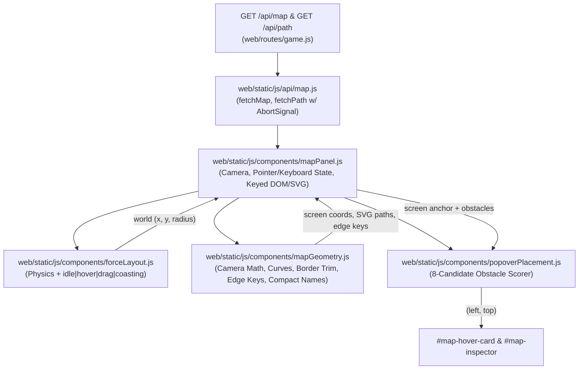

> [!NOTE]
> This document specifies **technical system architecture only** (data flow, storage, APIs, concurrency, state synchronization, and security).
> All visual, aesthetic, and UI design decisions (colors, typography, component styling, responsive layout) must be defined in `design.md`.

## Context

Open Dungeon's spatial map backend (`engine/memory/roomMap.js`, `engine/memory/pathfinding.js`, `engine/memory/structuredStore.js`) produces a renderer-agnostic graph payload at `GET /api/map` and deterministic directed walk routes at `GET /api/path`. On the frontend (`web/static/js/`), the app uses zero-build native ESM modules (`<script type="module">`) with no bundler.

Currently, `web/static/js/components/mapPanel.js` renders a rigid `(col, row)` grid with two modes (`cartographic` and `node-graph`). That grid layout has no collision avoidance or topology-driven clustering, and lacks hover previews, node inspection, pan/zoom, or pathfinding UI.

## System Architecture Diagram

## Goals / Non-Goals

**Goals:**
* Replace the rigid grid layout with a pure-JS ESM force-directed physics engine (`forceLayout.js`) that guarantees zero orb overlap among unpinned nodes and scales node radii/masses by weighted edge degree.
* Extract all pure geometric, camera, label-formatting, and edge-key matching logic into `mapGeometry.js` so it is directly unit-testable under `node --test`.
* Isolate `popoverPlacement.js` as a pure, DOM-free 8-candidate obstacle-scoring module.
* Preserve the zero-build native ESM architecture and `.map-room[data-room-id]` DOM contract while adding `data-edge-key` on `.map-edge` elements.
* Implement the 200 ms hover dwell gate, 150 ms card dismissal grace, `(hover: hover) and (pointer: fine)` capability gating, `idle | hover | drag | coasting` state machine, in-memory `homeAnchors`/pins, and keyboard/touch accessibility.
* Wire `fetchPath()` in `api/map.js` to `GET /api/path` with `AbortController` stale-response protection.

**Non-Goals:**
* Modifying backend spatial reconciliation (`roomMap.js`), SQLite schemas (`structuredStore.js`), or `/api/map` / `/api/path` payloads.
* Persisting node positions in `localStorage` or SQLite (pins are strictly session in-memory).
* Adding WebAudio synth coupling (`AmbientSynth` from the reference handoff).
* Introducing a JS bundler, React, TypeScript, or external graph libraries (`cytoscape.min.js` remains unused).

## Technical Decisions

* **Three Pure-JS ESM Modules (`forceLayout.js`, `mapGeometry.js`, `popoverPlacement.js`):**
  * *Decision:* Keep all physics, coordinate math, antiparallel SVG curve geometry, compact naming, edge-key matching, and 8-candidate popover scoring out of `mapPanel.js` in pure, DOM-free ESM modules.
  * *Rationale:* Dungeon graphs are 1–200 rooms where $O(N^2)$ per tick takes < 0.2 ms; pure modules allow fast, deterministic `node --test` unit coverage without needing a browser.
* **Seeded PRNG + Warm-Start + Alpha-Threshold Pre-Settle:**
  * *Decision:* `forceLayout.js` uses a deterministic seeded PRNG (no `Math.random()`) for initial/new-node jitter. On `refreshMapPanel()`, existing rooms retain their `(x, y)` and in-memory `homeAnchors` (pruning vanished rooms); newly discovered rooms seed near their neighbor biased by compass direction; initial render runs until `alpha < 0.02` (capped at `MAX_PRESETTLE_TICKS = 120`) followed by a bounded collision-only relaxation pass before painting.
  * *Rationale:* Guarantees deterministic fresh layouts, eliminates turn-to-turn jumping, and ensures `.map-room.current-room` is settled inside `#map-canvas` on initial paint.
* **Keyed DOM Diff & Interaction State on Refresh:**
  * *Decision:* `refreshMapPanel()` reconciles existing `.map-room` and `.map-edge` nodes by key rather than clearing `#map-canvas-content`, prunes `homeAnchors` for deleted rooms, clears any active `.map-edge-route` (since `current_room_id` may have moved), and closes `#map-inspector` if its room vanished (or re-renders updated exits if it remains).
* **Single World↔Screen Coordinate Pipeline (`mapGeometry.js`):**
  * *Decision:* `worldToScreen`, `screenToWorld`, `zoomAtPoint`, and `computeFitViewport` live in `mapGeometry.js` and are shared by rendering, hit testing, obstacle snapshots, and popover anchoring.
* **Stale-Response Guard for `ROUTE HERE`:**
  * *Decision:* `mapPanel.js` cancels any in-flight `fetchPath` request via `AbortController` whenever a new route is requested, the inspector closes, or `refreshMapPanel()` runs.

## Risks / Trade-offs

* **[Risk] Hover dwell firing during drag or coasting** → *Mitigation:* Enforce `idle | hover | drag | coasting` in `forceLayout.js`; `hover()` is a no-op during `drag`/`coasting`, and `pointerdown`/`pointerleave`/`pointercancel` clear the dwell timer.
* **[Risk] Mobile touch scrolling stealing drag/pinch-zoom** → *Mitigation:* Apply `touch-action: none` on `#map-canvas`, track active pointers in a `Map` for 1-finger pan vs 2-finger pinch-zoom, use `setPointerCapture`, and handle `pointercancel` via `dragEnd({ cancel: true })`.
* **[Risk] Existing scroll-based centering E2E test (`test_map_panel_fits_sidebar_and_centres_current_room`) incompatible with camera transform** → *Mitigation:* Rewrite that test in `tests/e2e/test_map_render.py` to assert `getBoundingClientRect()` containment and `FIT` framing instead of `offsetLeft`/`offsetWidth` scroll bounds.

## Migration & Rollback Plan

* No database or API migrations required. Rollback is a pure frontend revert of `web/static/js/components/`, `web/static/js/api/map.js`, `web/templates/index.html`, `web/static/style.css`, and `tests/e2e/test_map_render.py`.
